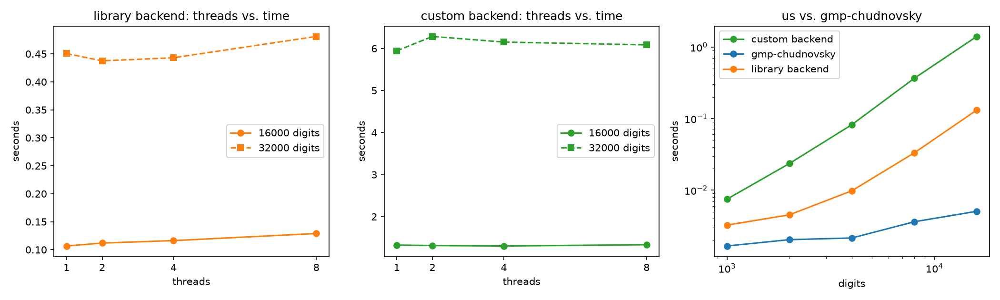

# pi

Computes pi (and the square root of pi) to as many digits as you want, using
the Chudnovsky algorithm with binary splitting. Two backends: one built on
Boost.Multiprecision, one with a BigInt/BigFloat written from scratch.

## Requirements

| Tool | What it's for | Debian/Ubuntu | Arch |
|---|---|---|---|
| CMake 3.25+ | configures and builds the project | `apt install cmake` | `pacman -S cmake` |
| C++23 compiler | gcc/clang | - | - |
| Boost (header-only `multiprecision`) | big-integer math for the `library` backend | `apt install libboost-dev` | `pacman -S boost` |
| libgmp + pkg-config | optional, only for `-DBUILD_REFERENCE=ON`, see below | `apt install libgmp-dev pkg-config` | `pacman -S gmp pkgconf` |
| clang-format + clang-tidy | optional, formatting/linting, see below | `apt install clang-format clang-tidy` | `pacman -S clang` |
| doxygen | optional, generates HTML docs, see below | `apt install doxygen` | `pacman -S doxygen` |

Or install everything at once, optional stuff included:

```
# Debian/Ubuntu
apt install cmake libboost-dev libgmp-dev pkg-config clang-format clang-tidy doxygen

# Arch
pacman -S cmake boost gmp pkgconf clang doxygen
```

## Building

From the repo root:

```
cmake -B build
cmake --build build
```

Defaults to an optimized `Release` build (`-O3`) if you don't pass
`-DCMAKE_BUILD_TYPE=...` yourself. This matters here since the benchmark
numbers below are meaningless under an unoptimized build.

The binary ends up at `build/pi`.

Tests run through ctest as usual:

```
ctest --test-dir build
```

## Running it

```
pi --terms <n> [--backend library|custom] [--threads n] [--sqrt] [--benchmark]
pi --digits <n> [--backend library|custom] [--threads n] [--sqrt] [--benchmark]
```

- `--terms` / `--digits`: compute pi from a term count, or work backwards
  from a requested number of decimal digits. Pick one.
- `--backend`: `library` uses Boost's `cpp_int` for the big-integer math,
  `custom` uses my own BigInt/BigFloat. Default is `library`.
- `--threads`: how many threads to use for binary splitting. Default 1.
- `--sqrt`: print the square root of pi instead of pi, same precision either
  way.
- `--benchmark`: instead of printing digits, times the computation across
  a sweep of thread counts (1, 2, 4, ... up to the value you gave `--threads`,
  or up to hardware concurrency if you didn't) and prints the speedup per
  thread count. Also cross-checks that every thread count agrees on the
  result, mostly as a cheap correctness check on the parallel binary split.

No arguments at all just reads a term count from stdin.

## Comparing against gmp-chudnovsky

`gmp-chudnovsky.c` is GMP's own reference Chudnovsky implementation. Turning
on the CMake option builds it as a separate binary next to `pi`, so you can
time the two against each other by hand:

```
cmake -B build -DBUILD_REFERENCE=ON
cmake --build build
./build/gmp-chudnovsky 10000 0
```

It's off by default since it downloads a file and pulls in a GMP dependency
that the rest of the project doesn't otherwise need.

(`gmp-chudnovsky.c` doesn't compile as downloaded on a recent glibc: it
declares a variable named `fmul`, which collides with glibc's own `fmul`
declaration. The build patches the name automatically after downloading it.)

## Benchmarks



First two plots: for the **custom backend**, adding threads barely changes
the time at either digit count (16000 or 32000), since `binary_split_parallel`
only parallelizes the recursive splitting, not the actual big-integer
multiplication. That runs single threaded and is also the most expensive
part of the computation, so throwing more threads at the splitting doesn't
buy much.

For the **library backend**, time actually increases slightly with thread
count (e.g. ~0.107s at 1 thread vs. ~0.129s at 8 threads, for 16000 digits).
Boost's backend finishes fast enough (around a tenth of a second) that the
fixed cost of spawning `std::async` tasks outweighs any benefit from
parallel splitting.

Third plot: both backends against gmp-chudnovsky, log scale on both axes
since the gap spans orders of magnitude. gmp-chudnovsky (blue) grows the
slowest as digit count increases, while the library backend (orange) and the
custom backend (green) get slower much faster, because GMP's multiplication
is a lot better optimized than either of ours.

## Docs

The public headers in `include/pi/` have Doxygen comments. Generate HTML docs
with:

```
doxygen Doxyfile
```

from the repo root, then open `docs/html/index.html` directly in a browser,
no server needed. The search box needs a local server to work though, since
it does an XHR that `file://` blocks:

```
python3 -m http.server --directory docs/html 8000
```

then visit `http://localhost:8000`.